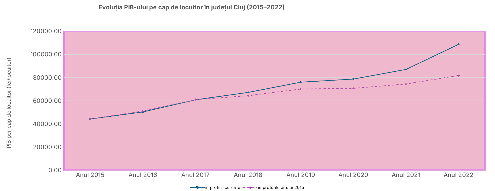

# GDP per capita and labour productivity in Cluj County, Romania (2015–2022)

For my Macroeconomic Statistics course at ASE I looked at how Cluj, one of the fastest growing economies in Romania, developed between 2015 and 2022. I focused on two indicators: GDP per capita, as a measure of how developed the county is, and labour productivity, meaning how much one employed person produces. I calculated both in current prices and in 2015 prices, because a large part of the nominal growth in these years comes from inflation.

The full report (in Romanian) is in [raport_cluj.pdf](raport_cluj.pdf), and all the calculations are in the Excel file.

## Results

Cluj's regional GDP grew every year, from 31.0 billion lei in 2015 to 74.3 billion lei in 2022. In current prices, GDP per capita went up about 2.5 times and productivity about 2.3 times. Once inflation is taken out, the picture is more modest: GDP per capita grew about 1.85 times and productivity by about 74%. The gap is largest in 2022, when nominal GDP grew by 20% but real GDP only by 5.5%.

The pandemic shows clearly in the data. 2020 had the smallest growth in both GDP and productivity, and in 2021 the number of employed people dropped by almost 23 thousand.

| | 2015 | 2019 | 2020 | 2021 | 2022 |
|---|---:|---:|---:|---:|---:|
| GDP per capita, current prices (lei) | 44,263 | 76,068 | 78,750 | 87,097 | 108,784 |
| GDP per capita, 2015 prices (lei) | 44,263 | 70,169 | 70,780 | 74,522 | 81,830 |
| Productivity, current prices (thousand lei) | 89.9 | 145.7 | 151.6 | 178.8 | 208.1 |
| Productivity, 2015 prices (thousand lei) | 89.9 | 134.4 | 136.2 | 153.0 | 156.6 |
| Real GDP growth (%) | – | 9.3 | 1.3 | 5.4 | 5.5 |

## Data and method

The data comes from the National Institute of Statistics (TEMPO Online): regional GDP, employed population and resident population for Cluj County, plus the monthly consumer price index (table IPC102E). I turned the monthly CPI into a yearly average, chained it to 2015 = 100 and used it to deflate the nominal indicators. Two things to keep in mind: the CPI is national, since there is no county-level index, and the resident population drops sharply in 2022, most likely because of the post-census revision, which slightly inflates the 2022 per capita values.

## Files

The Excel file has the original data, all the formulas and the charts, with the CPI data on a separate sheet. The data folder has the same data as a CSV and the CPI export from TEMPO Online, and the figures folder has the charts used in the report.

Ioana Galoș, Faculty of Cybernetics, Statistics and Economic Informatics, Bucharest University of Economic Studies (ASE)
